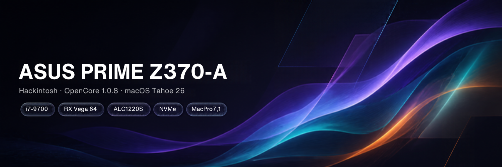
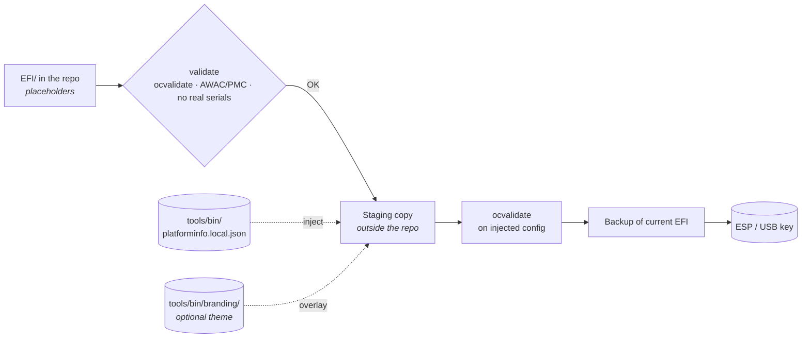

<!-- Generated from README.template.md by tools/render_readme.py. Edit the template, not README.md. -->

<p align="center">
  
</p>

<p align="center">
  
  
  
  
  <a href="https://github.com/lepekinoi/ASUS-PRIME-Z370-A-Hackintoshed/releases"></a>
</p>

<p align="center">
  <b>A clean, validated OpenCore EFI for a Coffee Lake desktop with an AMD Vega 64, running macOS Tahoe.</b><br>
  <sub>Every value in this README is generated from the EFI itself, so the documentation cannot drift from the config.</sub>
</p>

<p align="center">
  <a href="#-at-a-glance">At a glance</a> ·
  <a href="#-hardware">Hardware</a> ·
  <a href="#-bios-settings">BIOS</a> ·
  <a href="#-efi-contents">EFI contents</a> ·
  <a href="#usb-map">USB map</a> ·
  <a href="#-deployment">Deployment</a> ·
  <a href="#-design-decisions">Design decisions</a> ·
  <a href="#-troubleshooting">Troubleshooting</a>
</p>

---

## ✨ At a glance

| | Status | Notes |
|---|:---:|---|
| **Boot** macOS Tahoe 26.7.2 | ✅ | OpenCore 1.0.8, SIP enabled |
| **GPU** acceleration (RX Vega 64) | ✅ | Native, Metal 3, no WhateverGreen needed |
| **Ethernet** (Intel I219-V) | ✅ | `IntelMausi.kext` |
| **USB** 2 / 3 / 3.1 Gen2 / USB-C | ✅ | 3 controllers mapped with USBToolBox (`UTBMap.kext`), see [USB map](#usb-map) |
| **Thunderbolt** | ➖ | No Thunderbolt card, support **disabled** in BIOS on purpose |
| **CPU** power management | ✅ | XCPM via `SSDT-PLUG` |
| **Sensors** (CPU temp, fans) | ✅ | VirtualSMC plugins |
| **OTA updates** | ⚙️ | Kept possible with `RestrictEvents` + `revpatch=sbvmm` |
| **Onboard audio** (ALC1220S) | ❌ | macOS Tahoe removed AppleHDA, see [Known limitations](#-known-limitations) |
| **Wi-Fi / Bluetooth** | ➖ | No wireless card in this build, on purpose (no Tahoe-compatible module) |

---

## 🖥 Hardware

| Component | Model |
|---|---|
| **Motherboard** | ASUS PRIME Z370-A |
| **CPU** | Intel Core i7-9700 (Coffee Lake Refresh, 8C/8T) |
| **GPU** | Gigabyte Radeon RX Vega 64 8 GB |
| **iGPU** | Intel UHD 630, **disabled** in BIOS |
| **Audio** | Realtek ALC1220S |
| **Ethernet** | Intel I219-V |
| **Storage** | WD_BLACK SN850X 1 TB NVMe (PCIe 4.0 drive, runs at PCIe 3.0 x4 on Z370) |
| **USB** | Intel Z370 xHCI · ASMedia ASM2142 onboard (rear USB-C + USB 3.1 Gen2) · ASMedia ASM1242 PCIe card (2 × USB-C, SATA-powered) |
| **Wireless** | None (Bluetooth module removed on purpose) |
| **Thunderbolt** | None (`TB_HEADER` unused, support disabled in BIOS) |

---

## 🔧 BIOS settings

> [!IMPORTANT]
> Load **Optimized Defaults** (`F5`) first, then apply the settings below.

| | Setting | Path |
|:---:|---|---|
| 🔴 | Fast Boot → **Disabled** | Boot |
| 🔴 | Secure Boot → **Disabled** (OS Type: *Other OS*) | Boot → Secure Boot |
| 🔴 | CSM → **Disabled** | Boot → CSM |
| 🔴 | **CFG Lock** → **Disabled** | Advanced → CPU Power Management |
| 🔴 | VT-d → **Disabled** | Advanced → System Agent Configuration |
| 🔴 | Intel SGX → **Disabled** | Advanced → CPU Configuration |
| 🔴 | Intel PTT → **Disabled** | Advanced → PCH-FW Configuration |
| 🔴 | Serial Port → **Disabled** | Advanced → Onboard Devices |
| 🔴 | **iGPU Multi-Monitor** → **Disabled**, Primary Display → **PEG** | Advanced → System Agent → Graphics Configuration |
| 🔴 | **Thunderbolt support** → **Disabled** | Advanced → Thunderbolt Configuration |
| 🟢 | VT-x, Hyper-Threading, Execute Disable Bit → **Enabled** | Advanced → CPU Configuration |
| 🟢 | **Above 4G Decoding** → **Enabled** | Advanced → System Agent Configuration |
| 🟢 | XHCI / EHCI Hand-off → **Enabled** | Advanced → USB Configuration |
| 🔵 | SATA Mode → **AHCI** | Advanced → PCH Storage Configuration |

<details>
<summary><b>Why each setting matters</b></summary>

- **CFG Lock** must be off: macOS writes MSR `0xE2` during power management. `AppleXcpmCfgLock` stays enabled anyway as a safety net (see [Design decisions](#-design-decisions)).
- **iGPU off** is required by `MacPro7,1`, a model that has no integrated graphics. Leaving it on causes panics.
- **Above 4G Decoding** is mandatory for the Vega 64's large BAR.
- **VT-d off** lets `DisableIoMapper` stay off.
- **CSM on** produces `gIO` errors at the OpenCore picker; OpenCore needs pure UEFI.
- **AHCI**: macOS does not see disks in RAID mode.
- **Thunderbolt off**: the board only has a `TB_HEADER` for an optional ThunderboltEX 3 card, and none is installed. When enabled, the option reserves PCI bus numbers for it, which shifts the bus of the ASMedia controllers and breaks their entries in the [USB map](#usb-map).

</details>

<details>
<summary><b>PCIe ASPM (Advanced → Platform Misc Configuration)</b></summary>

Recommended: leave ASPM to the firmware and disable it on critical links.

| Setting | Value | Why |
|---|---|---|
| PCI Express Native Power Management | Disabled | Native control is unreliable on Z370 under macOS |
| Native ASPM | Disabled | Same |
| DMI Link ASPM Control | Disabled | The CPU ↔ PCH link must never stall |
| PEG ASPM | Disabled | Avoids GPU stutters and black screens on wake |
| PCH ASPM / L1 Substates | Disabled | Avoids latency spikes and spurious wakes |

</details>

---

## 📦 EFI contents

> [!NOTE]
> The tables below are generated from `EFI/OC/config.plist` and each kext's `Info.plist`.

### Kexts

| Kext | Version | State | Role |
|---|---|---|---|
| `Lilu.kext` | `1.7.2` | ✅ Enabled | Patching engine, required by every plugin below |
| `VirtualSMC.kext` | `1.3.7` | ✅ Enabled | SMC emulation |
| `SMCProcessor.kext` | `1.3.7` | ✅ Enabled | CPU temperature sensors |
| `SMCSuperIO.kext` | `1.3.7` | ✅ Enabled | Fan speed sensors |
| `RestrictEvents.kext` | `1.1.6` | ✅ Enabled | Keeps OTA updates working with MacPro7,1 (`revpatch=sbvmm`) |
| `NVMeFix.kext` | `1.1.3` | ✅ Enabled | NVMe power management (APST) for the WD_BLACK SN850X |
| `IntelMausi.kext` | `1.0.8` | ✅ Enabled | Intel I219-V Ethernet |
| `USBToolBox.kext` | `1.2.0` | ✅ Enabled | USB mapping driver |
| `UTBMap.kext` | `1.1` | ✅ Enabled | USB port map for this build (3 controllers, see [USB map](#usb-map)) |

### ACPI

| SSDT | State | Role |
|---|---|---|
| `SSDT-EC-USBX-DESKTOP.aml` | ✅ Enabled | Fake Embedded Controller + USB power |
| `SSDT-AWAC.aml` | ✅ Enabled | Brings back the legacy RTC clock on Z370 |
| `SSDT-PLUG-DRTNIA.aml` | ✅ Enabled | CPU power management (`plugin-type`) |

### Boot arguments

```text
keepsyms=1 revpatch=sbvmm
```

| Argument | Purpose |
|---|---|
| `revpatch=sbvmm` | With `RestrictEvents`, lets macOS offer updates to an unsupported Mac model |
| `keepsyms=1` | Readable kernel panic logs |

### USB map

Generated from `UTBMap.kext`. One row per physical socket; the label is the port name macOS shows in *System Information → USB*.

| Port | Controller | Connector | USB 2 | USB 3 |
|---|---|---|---|---|
| Facade USB 3 gauche | Intel Z370 (PCH) | USB 3 Type-A | `HS01` | `SS01` |
| Facade USB 3 droite | Intel Z370 (PCH) | USB 3 Type-A | `HS02` | `SS02` |
| Arriere USB 3 bleu 1 | Intel Z370 (PCH) | USB 3 Type-A | `HS03` | `SS03` |
| Arriere USB 3 bleu 2 | Intel Z370 (PCH) | USB 3 Type-A | `HS04` | `SS04` |
| Arriere USB 2 noir 1 | Intel Z370 (PCH) | USB 2 Type-A | `HS05` |  |
| Arriere USB 2 noir 2 | Intel Z370 (PCH) | USB 2 Type-A | `HS06` |  |
| Arriere USB-C | ASMedia ASM2142 (onboard) `8:0:0` | USB-C (with switch) | `HS01` | `SS01` |
| Arriere USB 3.1 bleu ciel | ASMedia ASM2142 (onboard) `8:0:0` | USB 3 Type-A | `HS02` | `SS02` |
| PCIe USB-C 1 | ASMedia ASM1242 (PCIe card) `6:0:0` | USB-C (with switch) | `HS01` | `SS01` |
| PCIe USB-C 2 | ASMedia ASM1242 (PCIe card) `6:0:0` | USB-C (with switch) | `HS02` | `SS02` |

18 ports mapped, at most 15 per controller.

> [!IMPORTANT]
> The Intel controller is matched by its ACPI name (`XHC`). Both ASMedia controllers are matched by their macOS PCI address (`pcidebug`, `bus:device:function`), so this part of the map only applies if:
>
> - the PCIe USB-C card stays in its current slot and stays powered by its SATA connector;
> - **Thunderbolt support stays disabled** in BIOS (enabling it shifts the bus numbers).
>
> Check under macOS with `ioreg -l -w0 | grep '"pcidebug"'`. If an ASMedia address differs, update its `pcidebug` value in `UTBMap.kext`. The ports keep working without a match, but lose their connector type and names.

<details>
<summary><b>Rebuilding the map</b></summary>

1. On Windows, run [USBToolBox](https://github.com/USBToolBox/tool) `Windows.exe` as administrator. Both ASMedia controllers must use the Microsoft driver (*USB xHCI Compliant Host Controller*): with the ASMedia driver, their ports are not detected.
2. **Discover**: plug a USB 2 device, then a USB 3 device, into every socket; plug USB-C devices in both orientations.
3. **Select**: keep at most 15 ports per controller, set the types (`T:<ports>:<type>`: 0 USB 2, 3 USB 3 Type-A, 9 USB-C with switch, 255 internal) and the names (`C:<port>:<name>`).
4. **Build** (`K`), then copy the new `UTBMap.kext` into `EFI/OC/Kexts/`. Windows numbers PCI buses differently: set each ASMedia `pcidebug` to the macOS value (Windows bus + 1 on this build) and give companion USB 2 / USB 3 ports the same name.
5. Run `validate` and `tools/render_readme.py`.

</details>

---

## 🚀 Deployment

The repository is public, so `config.plist` only contains **placeholder serials**. Real `PlatformInfo` values live in a git-ignored file and are injected into a temporary copy at deploy time.



### 1. Generate your own serials

Use [GenSMBIOS](https://github.com/corpnewt/GenSMBIOS) for `MacPro7,1` and check on [checkcoverage.apple.com](https://checkcoverage.apple.com) that the serial is **not** valid (not used by a real Mac). Use GenSMBIOS to generate only: do not let it write into the repository `config.plist`.

Store the values in the git-ignored `tools/bin/platforminfo.local.json`. `ROM` is the MAC address of the Intel Ethernet port, without separators:

```json
{
  "PlatformInfo/Generic/SystemSerialNumber": "F5KXXXXXXXXX",
  "PlatformInfo/Generic/MLB": "F5KXXXXXXXXXXXXXX",
  "PlatformInfo/Generic/SystemUUID": "00000000-0000-0000-0000-000000000000",
  "PlatformInfo/Generic/ROM": "001122334455"
}
```

If real values ever end up in `config.plist`, move them out before any commit:

```bash
python3 tools/inject_platforminfo.py export   # config.plist -> JSON
python3 tools/inject_platforminfo.py sanitize # placeholders back in config.plist
```

### 2. Deploy

| From | Target | Command |
|---|---|---|
| **macOS** | Internal ESP | `./tools/sync-esp.sh disk0s1` |
| **Windows** (admin) | USB key | `.\tools\deploy-usb.ps1 -Drive E` |

Add `--debug-boot` (macOS) or `-DebugBoot` (Windows) for a verbose boot with OpenCore file logs. Both only change the deployed copy, never the repository.

The target must be a FAT32 partition. The previous `EFI` folder is backed up first (`~/EFI-backups/` on Windows), then replaced.

Windows prerequisites: Python 3 in `PATH` (not the Microsoft Store alias) and `ocvalidate.exe` from the matching OpenCore release in `tools/bin/`.

<details>
<summary><b>Optional: custom boot picker theme</b></summary>

A theme can be kept out of the public repository in the git-ignored `tools/bin/branding/` folder. Both deploy scripts apply it to the staging copy through `tools/branding_overlay.py`:

| Path | Effect |
|---|---|
| `tools/bin/branding/EFI/` | Copied over the staged `EFI/`, e.g. `OC/Resources/Image/<Vendor>/<Theme>/` |
| `tools/bin/branding/config.json` | `config.plist` keys to override, e.g. `{"Misc/Boot/PickerVariant": "Vendor\\Theme"}` |

Unknown keys, wrong value types and a `PickerVariant` without its icons stop the deployment. Without the folder, the repository EFI ships unchanged.

</details>

### 3. Validate before every commit

```bash
./tools/validate.sh                                           # macOS
powershell -ExecutionPolicy Bypass -File tools/validate.ps1   # Windows
```

Requires `ocvalidate` from the matching OpenCore release in `tools/bin/`.

---

## 🧭 Design decisions

These choices are deliberate. Please don't "fix" them without reading why.

| Choice | Why |
|---|---|
| **SMBIOS `MacPro7,1`** | dGPU-only model: full Vega 64 acceleration and hardware DRM. About This Mac shows a *Mac Pro (2019)* with the real Core i7. |
| **`RestrictEvents` + `revpatch=sbvmm`** | `MacPro7,1` is not a Coffee Lake model; this pair keeps software updates available. Remove either and OTA stops. |
| **`SecureBootModel = Disabled`** | Required by Dortania for macOS 14.4 to 26.x with this setup. With `Default`, the Tahoe installer loops at the end of its second phase. |
| **No WhateverGreen** | AMD connector patching is broken on macOS 26, and the Vega 64 works natively with `MacPro7,1`. |
| **`AppleXcpmCfgLock = YES`** | CFG Lock is unlocked in BIOS; the quirk stays on as a safety net if a BIOS reset locks MSR `0xE2` again. `AppleCpuPmCfgLock` stays off (legacy path, unused on Coffee Lake). |
| **`SSDT-AWAC`, no `SSDT-PMC`** | Z370 needs `SSDT-AWAC` for the RTC. `SSDT-PMC` only applies to true 300-series chipsets (Z390, B360…) and is not shipped; `validate` still fails if both are enabled. |
| **Thunderbolt disabled in BIOS** | No Thunderbolt card is installed. The option would only reserve PCI resources and shift the ASMedia bus numbers used by the USB map. |
| **No Wi-Fi / Bluetooth** | No module is supported on Tahoe at this time; the Bluetooth module was unplugged and its internal USB port is not mapped. |
| **ASMedia USB matched by `pcidebug`** | Both ASMedia controllers share the ACPI name `PXSX`, so their PCI address is the only stable way to tell them apart. The PCIe card must stay in its slot. |
| **Only loaded files ship** | Every driver, kext and resource in `EFI/` is referenced by `config.plist`. Unused OpenCore drivers, tools and the Syrah/Chardonnay themes are not included. |

---

## 🚧 Known limitations

- **No onboard audio on Tahoe.** macOS 26 no longer ships `AppleHDA.kext`, so AppleALC has nothing to patch and the EFI ships no audio kext. Use a USB audio interface or HDMI/DisplayPort audio.
- **No Wi-Fi / Bluetooth.** No wireless card is installed and the EFI ships no wireless kexts.
- **No Thunderbolt.** Adding a ThunderboltEX 3 card means re-enabling Thunderbolt in BIOS, adding Thunderbolt SSDTs, and updating the ASMedia `pcidebug` values of the [USB map](#usb-map).
- **The PCIe USB-C card is tied to its slot** and needs its SATA power cable. Moving it breaks its USB map entry (ports still work, unnamed).
- **The front panel USB-C socket of the case is not connected**: the board has no USB-C front header.

---

## 🩺 Troubleshooting

<details>
<summary><b>Black screen right after the OpenCore picker</b></summary>

`OpenCore.efi`, `BOOTx64.efi` and `OpenRuntime.efi` must come from the **same** OpenCore release. A mismatch is the most common cause.
</details>

<details>
<summary><b>Installer reboots in a loop at the end of phase 2</b></summary>

Check that `Misc → Security → SecureBootModel` is `Disabled`.
</details>

<details>
<summary><b>Need logs</b></summary>

Deploy with `--debug-boot` / `-DebugBoot`. You get `-v debug=0x100`, OpenCore logs written to the ESP root (`opencore-*.txt`), and panic logs saved instead of an instant reboot.
</details>

<details>
<summary><b>USB-C or PCIe card ports have no name / wrong type in macOS</b></summary>

The ASMedia `pcidebug` address no longer matches: Thunderbolt was re-enabled in BIOS or the card moved. Compare `ioreg -l -w0 | grep '"pcidebug"'` with `UTBMap.kext` and update the value (see [USB map](#usb-map)).
</details>

<details>
<summary><b>USBToolBox on Windows does not see the ASMedia ports</b></summary>

The ASMedia Windows driver hides them. In Device Manager, switch each *ASMedia USB 3.1 eXtensible Host Controller* to *USB xHCI Compliant Host Controller* (Microsoft), or remove the ASMedia driver packages with `pnputil /delete-driver <oemNN.inf> /uninstall /force`, then reboot.
</details>

<details>
<summary><b><code>ocvalidate</code> reports missing keys</b></summary>

Your `ocvalidate` and OpenCore versions differ. Use the binary from the same release as `OpenCore.efi`.
</details>

---

## 🙏 Credits

- [Acidanthera](https://github.com/acidanthera) for OpenCore, Lilu and its plugins
- [Dortania](https://dortania.github.io/OpenCore-Install-Guide/) for the install guide
- [USBToolBox](https://github.com/USBToolBox) for USB mapping
- [CorpNewt](https://github.com/corpnewt) for GenSMBIOS and ProperTree

<p align="center"><sub>Not affiliated with Apple or ASUS. For educational use on hardware you own.</sub></p>
