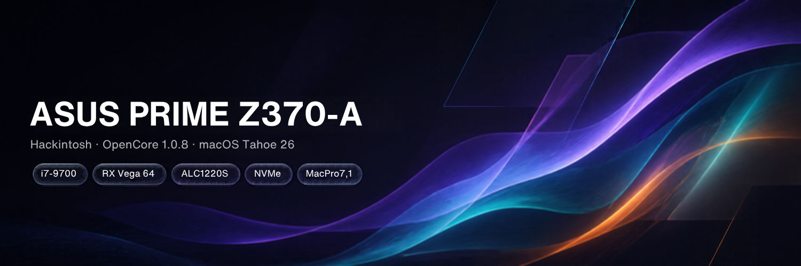
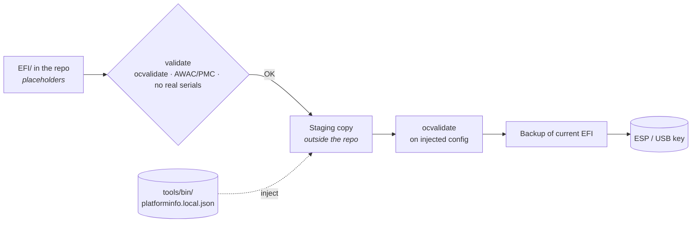

<!-- Generated from README.template.md by tools/render_readme.py. Edit the template, not README.md. -->

<p align="center">
  
</p>

<p align="center">
  
  
  
  
  <a href="https://github.com/lepekinoi/ASUS-PRIME-Z370-A-Hackintoshed/releases"></a>
</p>

<p align="center">
  <b>A clean, validated OpenCore EFI for a Coffee Lake desktop with an AMD Vega 64, running macOS Tahoe.</b><br>
  <sub>Every value in this README is generated from the EFI itself, so the documentation cannot drift from the config.</sub>
</p>

<p align="center">
  <a href="#-at-a-glance">At a glance</a> ·
  <a href="#-hardware">Hardware</a> ·
  <a href="#-bios-settings">BIOS</a> ·
  <a href="#-efi-contents">EFI contents</a> ·
  <a href="#-deployment">Deployment</a> ·
  <a href="#-design-decisions">Design decisions</a> ·
  <a href="#-troubleshooting">Troubleshooting</a>
</p>

---

## ✨ At a glance

| | Status | Notes |
|---|:---:|---|
| **Boot** macOS Tahoe 26.7.2 | ✅ | OpenCore 1.0.8, SIP enabled |
| **GPU** acceleration (RX Vega 64) | ✅ | Native, Metal 3, no WhateverGreen needed |
| **Ethernet** (Intel I219-V) | ✅ | `IntelMausi.kext` |
| **USB** | ✅ | Mapped with USBToolBox (`UTBMap.kext`) |
| **CPU** power management | ✅ | XCPM via `SSDT-PLUG` |
| **Sensors** (CPU temp, fans) | ✅ | VirtualSMC plugins |
| **OTA updates** | ⚙️ | Kept possible with `RestrictEvents` + `revpatch=sbvmm` |
| **Onboard audio** (ALC1220S) | ❌ | macOS Tahoe removed AppleHDA, see [Known limitations](#-known-limitations) |
| **Wi-Fi / Bluetooth** | ➖ | No wireless card in this build |

---

## 🖥 Hardware

| Component | Model |
|---|---|
| **Motherboard** | ASUS PRIME Z370-A |
| **CPU** | Intel Core i7-9700 (Coffee Lake Refresh, 8C/8T) |
| **GPU** | Gigabyte Radeon RX Vega 64 8 GB |
| **iGPU** | Intel UHD 630, **disabled** in BIOS |
| **Audio** | Realtek ALC1220S |
| **Ethernet** | Intel I219-V |
| **Storage** | Toshiba THNSNJ512 512 GB SATA SSD |
| **Wireless** | None |

---

## 🔧 BIOS settings

> [!IMPORTANT]
> Load **Optimized Defaults** (`F5`) first, then apply the settings below.

| | Setting | Path |
|:---:|---|---|
| 🔴 | Fast Boot → **Disabled** | Boot |
| 🔴 | Secure Boot → **Disabled** (OS Type: *Other OS*) | Boot → Secure Boot |
| 🔴 | CSM → **Disabled** | Boot → CSM |
| 🔴 | **CFG Lock** → **Disabled** | Advanced → CPU Power Management |
| 🔴 | VT-d → **Disabled** | Advanced → System Agent Configuration |
| 🔴 | Intel SGX → **Disabled** | Advanced → CPU Configuration |
| 🔴 | Intel PTT → **Disabled** | Advanced → PCH-FW Configuration |
| 🔴 | Serial Port → **Disabled** | Advanced → Onboard Devices |
| 🔴 | **iGPU Multi-Monitor** → **Disabled**, Primary Display → **PEG** | Advanced → System Agent → Graphics Configuration |
| 🟢 | VT-x, Hyper-Threading, Execute Disable Bit → **Enabled** | Advanced → CPU Configuration |
| 🟢 | **Above 4G Decoding** → **Enabled** | Advanced → System Agent Configuration |
| 🟢 | XHCI / EHCI Hand-off → **Enabled** | Advanced → USB Configuration |
| 🔵 | SATA Mode → **AHCI** | Advanced → PCH Storage Configuration |

<details>
<summary><b>Why each setting matters</b></summary>

- **CFG Lock** must be off: macOS writes MSR `0xE2` during power management. `AppleXcpmCfgLock` stays enabled anyway as a safety net (see [Design decisions](#-design-decisions)).
- **iGPU off** is required by `MacPro7,1`, a model that has no integrated graphics. Leaving it on causes panics.
- **Above 4G Decoding** is mandatory for the Vega 64's large BAR.
- **VT-d off** lets `DisableIoMapper` stay off.
- **CSM on** produces `gIO` errors at the OpenCore picker; OpenCore needs pure UEFI.
- **AHCI**: macOS does not see disks in RAID mode.

</details>

<details>
<summary><b>PCIe ASPM (Advanced → Platform Misc Configuration)</b></summary>

Recommended: leave ASPM to the firmware and disable it on critical links.

| Setting | Value | Why |
|---|---|---|
| PCI Express Native Power Management | Disabled | Native control is unreliable on Z370 under macOS |
| Native ASPM | Disabled | Same |
| DMI Link ASPM Control | Disabled | The CPU ↔ PCH link must never stall |
| PEG ASPM | Disabled | Avoids GPU stutters and black screens on wake |
| PCH ASPM / L1 Substates | Disabled | Avoids latency spikes and spurious wakes |

</details>

---

## 📦 EFI contents

> [!NOTE]
> The tables below are generated from `EFI/OC/config.plist` and each kext's `Info.plist`.

### Kexts

| Kext | Version | State | Role |
|---|---|---|---|
| `Lilu.kext` | `1.7.2` | ✅ Enabled | Patching engine, required by every plugin below |
| `AppleALC.kext` | `1.9.7` | ✅ Enabled | ALC1220S layout `7`, no effect on Tahoe without AppleHDA |
| `VirtualSMC.kext` | `1.3.7` | ✅ Enabled | SMC emulation |
| `IntelMausi.kext` | `1.0.8` | ✅ Enabled | Intel I219-V Ethernet |
| `WhateverGreen.kext` | `1.7.0` | ⚪ Disabled | GPU patches, not needed for the Vega 64 on Tahoe |
| `RestrictEvents.kext` | `1.1.6` | ✅ Enabled | Keeps OTA updates working with MacPro7,1 (`revpatch=sbvmm`) |
| `NVMeFix.kext` | `1.1.3` | ✅ Enabled | NVMe power management, optional (this build runs on SATA) |
| `USBToolBox.kext` | `1.2.0` | ✅ Enabled | USB mapping driver |
| `UTBMap.kext` | `1.1` | ✅ Enabled | USB port map for this board |
| `SMCProcessor.kext` | `1.3.7` | ✅ Enabled | CPU temperature sensors |
| `SMCSuperIO.kext` | `1.3.7` | ✅ Enabled | Fan speed sensors |

### ACPI

| SSDT | State | Role |
|---|---|---|
| `SSDT-EC-USBX-DESKTOP.aml` | ✅ Enabled | Fake Embedded Controller + USB power |
| `SSDT-PMC.aml` | ⚪ Disabled | Alternative to SSDT-AWAC, mutually exclusive |
| `SSDT-AWAC.aml` | ✅ Enabled | Brings back the legacy RTC clock on Z370 |
| `SSDT-PLUG-DRTNIA.aml` | ✅ Enabled | CPU power management (`plugin-type`) |

### Boot arguments

```text
-alcbeta keepsyms=1 revpatch=sbvmm alcid=7
```

| Argument | Purpose |
|---|---|
| `revpatch=sbvmm` | With `RestrictEvents`, lets macOS offer updates to an unsupported Mac model |
| `alcid=7` | AppleALC layout for the ALC1220S |
| `-alcbeta` | Allows AppleALC on a macOS version it does not officially support yet |
| `keepsyms=1` | Readable kernel panic logs |

---

## 🚀 Deployment

The repository is public, so `config.plist` only contains **placeholder serials**. Real `PlatformInfo` values live in a git-ignored file and are injected into a temporary copy at deploy time.



### 1. Generate your own serials

Use [GenSMBIOS](https://github.com/corpnewt/GenSMBIOS) for `MacPro7,1`, then store the values locally:

```bash
python3 tools/inject_platforminfo.py export   # after filling them in config.plist once
python3 tools/inject_platforminfo.py sanitize # put the placeholders back before any commit
```

### 2. Deploy

| From | Target | Command |
|---|---|---|
| **macOS** | Internal ESP | `./tools/sync-esp.sh disk0s1` |
| **Windows** (admin) | USB key | `.\tools\deploy-usb.ps1 -Drive E` |

Add `--debug-boot` (macOS) or `-DebugBoot` (Windows) for a verbose boot with OpenCore file logs. Both only change the deployed copy, never the repository.

### 3. Validate before every commit

```bash
./tools/validate.sh                                           # macOS
powershell -ExecutionPolicy Bypass -File tools/validate.ps1   # Windows
```

Requires `ocvalidate` from the matching OpenCore release in `tools/bin/`.

---

## 🧭 Design decisions

These choices are deliberate. Please don't "fix" them without reading why.

| Choice | Why |
|---|---|
| **SMBIOS `MacPro7,1`** | dGPU-only model: full Vega 64 acceleration and hardware DRM. The CPU shows as *Xeon* in About This Mac, which is cosmetic. |
| **`RestrictEvents` + `revpatch=sbvmm`** | `MacPro7,1` is not a Coffee Lake model; this pair keeps software updates available. Remove either and OTA stops. |
| **`SecureBootModel = Disabled`** | Required by Dortania for macOS 14.4 to 26.x with this setup. With `Default`, the Tahoe installer loops at the end of its second phase. |
| **WhateverGreen disabled** | AMD connector patching is broken on macOS 26, and the Vega 64 works natively with `MacPro7,1`. |
| **`AppleXcpmCfgLock = YES`** | CFG Lock is unlocked in BIOS; the quirk stays on as a safety net if a BIOS reset locks MSR `0xE2` again. `AppleCpuPmCfgLock` stays off (legacy path, unused on Coffee Lake). |
| **`SSDT-AWAC` *or* `SSDT-PMC`** | Mutually exclusive. `SSDT-AWAC` is the one in use; `validate` fails if both are enabled. |

---

## 🚧 Known limitations

- **No onboard audio on Tahoe.** macOS 26 no longer ships `AppleHDA.kext`. AppleALC loads with layout `7`, but there is no Apple audio driver for it to patch. Use USB or HDMI/DisplayPort audio.
- **No Wi-Fi / Bluetooth.** No wireless card is installed and the EFI ships no wireless kexts.

---

## 🩺 Troubleshooting

<details>
<summary><b>Black screen right after the OpenCore picker</b></summary>

`OpenCore.efi`, `BOOTx64.efi` and `OpenRuntime.efi` must come from the **same** OpenCore release. A mismatch is the most common cause.
</details>

<details>
<summary><b>Installer reboots in a loop at the end of phase 2</b></summary>

Check that `Misc → Security → SecureBootModel` is `Disabled`.
</details>

<details>
<summary><b>Need logs</b></summary>

Deploy with `--debug-boot` / `-DebugBoot`. You get `-v debug=0x100`, OpenCore logs written to the ESP root (`opencore-*.txt`), and panic logs saved instead of an instant reboot.
</details>

<details>
<summary><b><code>ocvalidate</code> reports missing keys</b></summary>

Your `ocvalidate` and OpenCore versions differ. Use the binary from the same release as `OpenCore.efi`.
</details>

---

## 🙏 Credits

- [Acidanthera](https://github.com/acidanthera) for OpenCore, Lilu and its plugins
- [Dortania](https://dortania.github.io/OpenCore-Install-Guide/) for the install guide
- [USBToolBox](https://github.com/USBToolBox) for USB mapping
- [CorpNewt](https://github.com/corpnewt) for GenSMBIOS and ProperTree

<p align="center"><sub>Not affiliated with Apple or ASUS. For educational use on hardware you own.</sub></p>
